Au début du XXe siècle, l’ethnographe Emil Torday recueille à la cour du royaume kuba, au centre de l’actuelle République démocratique du Congo, un récit qui commence ainsi : au commencement, il n’y avait que les ténèbres et l’eau ; et Bumba régnait seul. Pris de douleurs d’estomac, il vomit le soleil, puis la lune et les étoiles[^1]. Quelques années plus tôt, à des milliers de kilomètres de là, l’égyptologue James Henry Breasted traduisait un texte gravé vers 700 avant notre ère où le dieu Ptah conçoit toute chose dans son cœur avant de la faire exister par sa langue[^2]. Entre ces deux images, le vomissement et la parole, il y a presque toute la variété des récits africains de l’origine.

On parle généralement de « la » cosmogonie africaine, comme s’il existait un récit commun dont chaque peuple aurait une version. Les sources ne le permettent pas ! En effet, les récits diffèrent par leurs personnages, leur manière de créer, leur place dans la religion et certains peuples n’en ont pas du tout. Les théologiens Yongbo Han et Jaco Beyers rappellent que, selon Gabriel Setiloane, les Sotho-Tswana n’ont pas de récit de création, et que, selon Okot p’Bitek, la langue des Luo centraux n’a pas de mot pour « créer »[^3]. Robin Horton cite aussi les Nyakyusa de Tanzanie, chez qui l’anthropologue Monica Wilson n’a trouvé aucune figure de créateur du monde[^4]. Dans ce dossier, nous parlerons donc de cosmogonies au pluriel.

Il faut aussi distinguer trois sortes de documents. D'une part, nous avons les récits recueillis oralement par des voyageurs, des missionnaires ou des ethnologues, puis mis par écrit par eux. D'une autre part, nous avons les rites, qui mettent en scène l’origine sans la raconter. Enfin, il y a les textes savants, élaborés par des spécialistes : prêtres de Memphis, « docteurs » dogon, griots des Kéita du Mandé. Ces documents n’ont ni le même statut ni la même diffusion. Torday signale ainsi que les Bushongo avaient un dignitaire, le *moaridi*, chargé de conserver les anciennes traditions[^5], et Germaine Dieterlen que le mythe de la création des Malinké était récité toute une nuit, tous les sept ans, à l’intérieur du sanctuaire de Kangaba, par une seule famille de griots[^6].

> [!NOTE]
> **Cosmogonie** : du grec *kosmos*, « ordre, monde », et *gonos*, « naissance ». Le mot désigne un récit ou une doctrine sur l’origine du monde. On le distingue de l’anthropogonie, qui raconte l’origine des humains, et de la théogonie, qui raconte celle des dieux. Beaucoup de récits africains mêlent les trois.

## La sortie des eaux

Les plus anciens textes viennent d’Égypte, avec différentes histoires. Breasted le relevait déjà en 1912 : chaque grand temple voulait associer l’apparition du soleil à sa propre ville. À Memphis, Ptah avait façonné l’œuf d’où sortait le dieu solaire ; ailleurs, le jeune soleil était caché dans un lotus né de l’eau. À Héliopolis, il était apparu sous la forme d’un phénix posé sur la pierre sacrée du temple, le *benben*[^7]. Dans tous les cas, au commencement, il n’y a qu’un océan primordial, le Noun, d’où émerge [Atoum](fiche:atoum).

Les *Textes des Pyramides*, gravés dans les tombes royales de l’Ancien Empire, montrent Atoum tirant de lui-même le premier couple. Une formule du roi Mérenrê s’adresse à lui : « tu as brillé comme le Phénix de la pierre *ben* […]. Ce que tu as rejeté, c’était Shou ; ce que tu as craché, c’était Tefnout »[^8]. Le verbe appliqué à [Shou](fiche:shu) joue sur le son de son nom et sa traduction varie selon les égyptologues. L’oiseau sacré d’Héliopolis est le [Bennu](fiche:bennu), que les Grecs ont rapproché de leur phénix.

Vient ensuite la mise en place du monde. Shou, l’air, sépare la terre, [Geb](fiche:geb), du ciel, [Nout](fiche:nut). Ensuite, il continue de soutenir le ciel, les pieds posés sur la terre[^9]. La fiche consacrée à [la séparation de Nout et Geb](fiche:separation-nut-geb) montre que cet épisode est surtout connu par des allusions et par des images, non par un récit suivi. Le rôle d’Atoum, de Shou et de Tefnout dans l’ordre du monde est étudié dans [le dossier consacré à la Maât](dossier:maat-divinite-loi-cosmique-philosophie-de-vie).

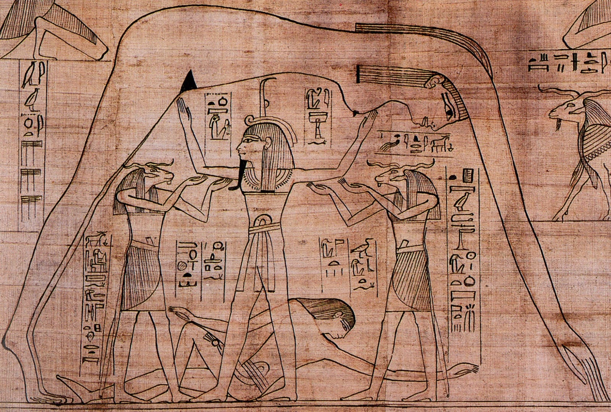

## Penser, façonner, vomir

### Ptah, le cœur et la langue

Le texte le plus célèbre sur la création par la parole est la « Théologie memphite », gravée sur une stèle du British Museum que l’on appelle la pierre de Shabaka. Les scribes qui l’ont gravée vers 700 avant notre ère, sous la XXVe dynastie, disent avoir recopié un vieux papyrus rongé par les vers. La pierre a ensuite servi de meule, ce qui a presque effacé l’inscription[^10]. Selon ce texte, [Ptah](fiche:ptah), le dieu de Memphis, est « le cœur et la langue » de l’ensemble des dieux. Les Égyptiens plaçaient la pensée dans le cœur. Ainsi, ce que les yeux voient et ce que les oreilles entendent remonte au cœur, qui forme la pensée, et la langue la répète. C’est par « la pensée du cœur et le commandement de la langue » que Ptah a fait tous les dieux, Atoum compris, les villes, les offrandes, les métiers et les mouvements du corps[^11].

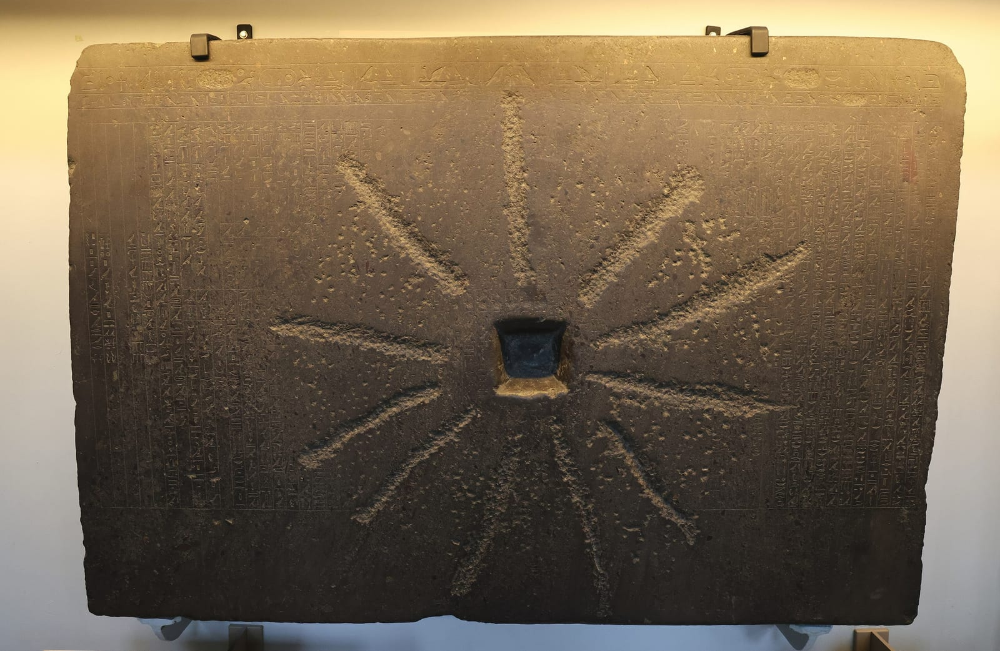

Il y a de nombreuses discussions autour de la date de ce texte depuis plus d’un siècle. En 1901, Breasted le situait au plus tard sous la XVIIIe dynastie. Après l’étude d’Adolf Erman en 1911, il se rallia à une date encore plus haute, à l’époque des pyramides, en se fondant sur l’orthographe[^12]. Cependant, la tendance s’est ensuite inversée. Leonard Lesko rappelait en 1987 que le texte n’est connu que par une copie tardive, vers 700 avant notre ère, et que l’original n’était peut-être pas beaucoup plus ancien[^13]. Les rapprochements avec le *Logos* grec ou avec la Genèse, que Breasted faisait volontiers, dépendent donc d’une datation qui reste incertaine.

### Khnoum le potier

D’autres textes égyptiens représentent la création comme un travail manuel. Le dieu bélier [Khnoum](fiche:khnoum), vénéré à Éléphantine et à Esna, modèle les êtres sur un tour de potier. Les *Admonitions*, une lamentation sur un pays en ruine, l’appellent le créateur des hommes et notent que, dans le désordre, « Khnoum ne façonne plus » d’enfants[^14]. Le potier ne s’oppose pas au dieu qui parle : les deux images coexistent dans la même religion.

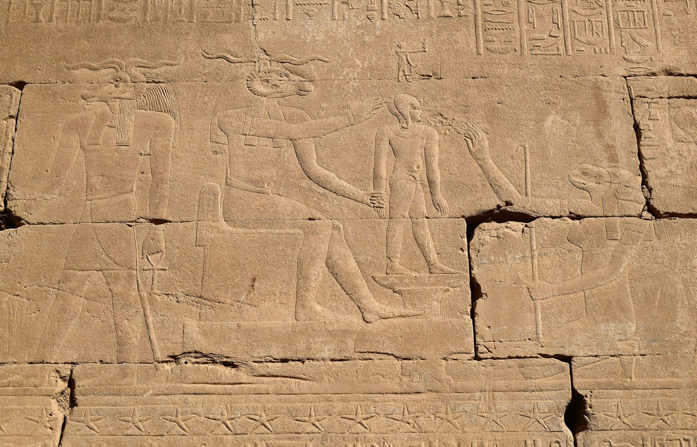

### Ọbàtálá et Odùduwà

Chez les Yoruba, la création est déléguée. Olọ́run, ou [Olódùmarè](fiche:olodumare), le maître du ciel, reste en retrait. Selon les prêtres interrogés par A.B. Ellis à la fin du XIXe siècle, il a fait [Ọbàtálá](fiche:obatala), lui a confié la conduite du ciel et du monde, puis s’est retiré pour se reposer[^15]. Un mythe, contredit par un autre, ajoute qu’Ọbàtálá a façonné dans l’argile le premier homme et la première femme, d’où ses titres de « maître de la meilleure argile » et d’« orisha qui pétrit l’argile ». Tous s’accordent, en revanche, pour dire qu’il forme l’enfant dans le ventre de sa mère et que les albinos et les enfants nés avec une malformation sont son œuvre[^16]. Le pasteur Samuel Johnson rapporte une idée voisine : l’homme a été fait par Dieu « d’un bloc » et façonné par Òrìṣàńlá, nom courant d’Ọbàtálá. Ses fidèles s’interdisent le vin de palme et les personnes nées avec un handicap lui sont consacrées[^17].

Le récit le plus connu aujourd’hui, où Ọbàtálá, envoyé créer la terre ferme, s’enivre de vin de palme et se fait devancer par [Odùduwà](fiche:oduduwa), n’apparaît ni chez Ellis ni chez Johnson[^18]. Les deux auteurs donnent d’autres versions. Pour Ellis, Odùduwà est une déesse, l’épouse d’Ọbàtálá et la terre unie au ciel. Les deux époux ressemblent à deux calebasses refermées l’une sur l’autre. Pour certains prêtres, il s'agit même d'une seule divinité à deux sexes[^19]. Johnson, quant à lui, rapporte une tradition où le fils d’Odùduwà, Ọ̀rànmíyàn, reçoit en héritage un chiffon contenant de la terre, vingt et un morceaux de fer et un coq. Comme la terre est entièrement couverte d’eau, il y dépose sa part et le coq gratte la terre jusqu’à faire apparaître le sol ferme. Johnson tenait ce récit pour une simple « parodie » de la création ou du déluge et préférait une explication politique : la terre appartient à l’Aláàfin d’Ọ̀yọ́[^20]. Enfin, Ellis décrit aussi un déluge envoyé par Olókun, où Ọbàtálá sauve quelques humains en les hissant au ciel avec une chaîne de fer, et qu’il croyait emprunté à l’islam[^21].

### Bumba, le dieu qui vomit

Le récit kuba est l’un des seuls où la création passe par le vomissement. [Bumba](fiche:bumba), que Torday appelle « le Chembe (Dieu) », est un géant de couleur blanche. Il vomit le soleil, dont la chaleur fait évaporer les eaux et apparaître des bancs de sable, puis la lune et les étoiles. Il vomit ensuite neuf animaux, du léopard à la chèvre, et enfin les hommes[^22]. Les animaux vomissent à leur tour leurs semblables :

- le héron, tous les oiseaux sauf le milan ;
- le crocodile, les serpents ;
- la chèvre, les bêtes à cornes.

Un des fils de Bumba meurt à la tâche en vomissant les termites, qui recouvrent alors de terre noire les bancs de sable pour l’enterrer[^23]. Le récit complet est présenté dans la fiche [le mythe de la création selon les Kuba](fiche:mythe-creation-bumba).

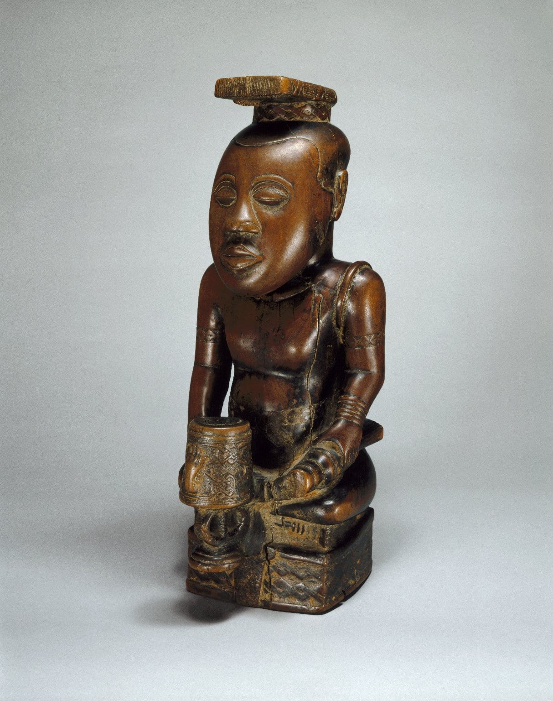

La fin du récit ouvre l’histoire. Bumba donne à chaque village un interdit alimentaire, chasse au ciel la foudre trop destructrice, puis désigne trois chefs, dont Loko Yima, « Dieu sur terre », avant de s’élever dans les airs et de disparaître[^24]. Le mythe sert d’ouverture à la liste des rois kuba. Torday lui-même remarque que ses premières phrases « rappellent nettement » la Genèse[^25]. La version connue repose presque entièrement sur sa transcription.

## Le couple, le double et le désordre

### Mawu, Lisa et le serpent arc-en-ciel

Dans les sources sur le bas Bénin, la création est associée tantôt à un couple, tantôt à un dieu du ciel. Selon l’ethnographe Bernard Maupoil, en 1943, les vodun Legba et Gu ont été créés par [Mawu-Lisa](fiche:mawu-lisa), « couple créateur et divinités suprêmes »[^26]. Les auteurs du XIXe siècle donnent une image plus éclatée. En 1874, John Skertchly appelle « Mau » (Mawu) l’être suprême du royaume du Dahomey, trop haut pour se soucier des hommes. Cependant, il range parmi les divinités secondaires Lisa, le soleil, dont le caméléon est le messager, et un autre Mau, la lune[^27].

Ellis, en 1890, fait de Mawu le dieu du ciel des peuples de langue ewe, le plus puissant mais, selon lui, ni créateur ni maître des autres dieux. Il attribue l’idée contraire aux missionnaires allemands et aux habitants des villes de la côte, en contact avec les Européens[^28]. Chez lui, Lisa, le soleil, a pour épouse Gleti, la lune ; et c’est ce couple qui, selon certains, a fait l’homme[^29].

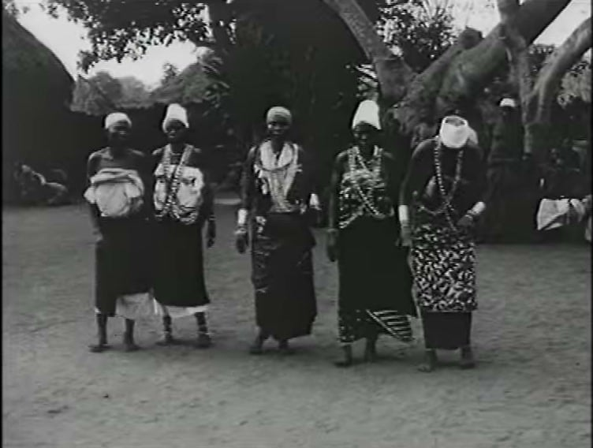

Ellis décrit aussi un grand serpent arc-en-ciel, Anyi-ewo, qui sort de dessous la terre pour boire au ciel l’eau que Mawu y garde en réserve. À Ouidah et à Porto-Novo, il s’appelle Aido-wedo. Son excrément change le maïs en cauris, d’où l’idée qu’il donne la richesse[^30]. Les récits du XXe siècle, où ce serpent porte la créatrice pendant qu’elle façonne le monde et où une divinité plus ancienne, Nana Buluku, met au monde Mawu et Lisa, sont présentés dans les fiches de [Dan Aido Hwedo](fiche:dan-aido-hwedo) et de [Nana Buluku](fiche:nana-buluku). Les sources réunies ici ne permettent pas de dire si les écarts entre ces versions et celles du XIXe siècle tiennent aux narrateurs, aux régions ou aux enquêteurs.

### Pemba et Faro

Chez les Bambara et les Malinké du Mali, la création se fait en deux temps : une première création hâtive et impure, puis une remise en ordre. Ces récits sont connus surtout par Germaine Dieterlen. Dans son *Essai sur la religion bambara* (1951), tel que le présente l’helléniste Henri Jeanmaire, la création est l’extériorisation d’une pensée divine. [Pemba](fiche:pemba), sous la forme d’une graine d’acacia, crée par des « tourbillonnements », puis donne l’être à la première femme, Mousso Koroni, qui peuple la terre de plantes et d’animaux dans le désordre. Leur querelle, la trahison de Mousso Koroni, sa fuite et sa folie répandent l’impureté. [Faro](fiche:faro), être androgyne des eaux, réorganise alors le monde, enseigne la parole et préside à la vie ainsi qu'à la réincarnation des hommes[^31]. L’ethnologue Solange de Ganay en avait publié des variantes importantes[^32].

La version malinké publiée par Dieterlen en 1955, recueillie auprès des Kéita de Kangaba et de leurs griots, est différente. Dieu, Mangala, crée d’abord une graine d’acacia, qui échoue, puis « l’œuf du monde », qui contient huit graines et deux paires de jumeaux de sexe opposé. Pemba en sort avant terme en arrachant un morceau de son placenta, qui devient une terre sèche et stérile. Faro, qui appartient à l’autre paire, est alors sacrifié au ciel et son corps, découpé, tombe sur la terre où les morceaux deviennent des arbres. Ressuscité sous forme humaine, il descend dans une arche avec les huit premiers ancêtres, les animaux et les plantes, sur les monts de Kouroula, au Mandé. Mousso Koroni, la jumelle de Pemba, descend « par le vent »[^33]. Viennent ensuite la première pluie et la révélation de la parole : l’ancêtre Simboumba Tangnagati sort de la mare en disant « *nko* », « je parle »[^34]. La fiche [le partage du monde entre Faro et Pemba](fiche:partage-monde-faro-pemba) montre comment ce récit fonde l’initiation.

Dieterlen précise que ce mythe est « réservé aux initiés », alors que le système social qui s’y appuie est connu de tous, musulmans compris[^35]. Les présentations publiées, les siennes comprises, n’en livrent qu’un aperçu.

### Amma, le Renard et les Nommo

La cosmogonie dogon est à la fois la plus détaillée et la plus discutée. Elle repose sur deux livres principaux. Le premier est *Dieu d’eau* de Marcel Griaule, publié en 1948, sur ses entretiens de 1946 avec un sage dogon, Ogotemmêli. Le second, *Le Renard pâle*, a été publié en 1965 par Germaine Dieterlen sous leur double signature, après la mort de Griaule[^36].

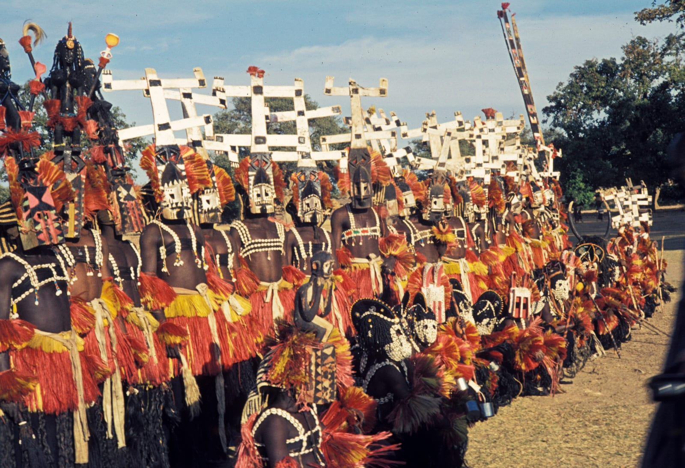

Dans *Le Renard pâle*, tel que le présente l’anthropologue Luc de Heusch, la création est l’œuvre du « verbe » d’un dieu unique, [Amma](fiche:amma). Il dessine des signes avant de créer, puis forme dans un double placenta deux couples de jumeaux androgynes. L’un des jumeaux, Ogo, brise trop tôt son placenta et en fait une terre sèche et inculte. Son jumeau, un [Nommo](fiche:nommo), est sacrifié au ciel pour apporter l’eau à cette terre. Ressuscité, il descend dans une arche avec quatre couples d’ancêtres humains et toutes les catégories d’êtres. Ogo, qui a échoué, devient le Renard pâle, Yurugu, figure du désordre qui fait aussi avancer le monde[^37]. Dans *Dieu d’eau*, c’est Amma lui-même qui s’unit à la Terre, faite d’une boule d’argile, et le Renard naît de cette union imparfaite[^38]. De Heusch voyait dans ces écarts la trace d’« écoles » différentes, et rappelait que, selon les auteurs eux-mêmes, il n’existe pas de texte dogon suivi du mythe : « il a donc fallu suivre l’information pour raconter le mythe »[^39].

> [!NOTE]
> **La controverse Griaule** : en 1991, l’anthropologue néerlandais Walter van Beek publie dans *Current Anthropology* une « réévaluation de terrain » des travaux de Griaule. Ses informateurs ne reconnaissent ni la version d’Ogotemmêli ni celle du *Renard pâle*. Selon lui, « les Dogon ne connaissent pas de véritable mythe de création ». Il attribue ce « savoir profond » à quelques informateurs particuliers, à leur désir de satisfaire un enquêteur lié au pouvoir colonial et à la construction de Griaule lui-même[^40]. L’article paraît avec les commentaires de plusieurs chercheurs. Luc de Heusch et Geneviève Calame-Griaule y répondent dans les numéros suivants, et van Beek leur réplique en 1992[^41].
> 
> D’autres lectures ont suivi. Pour l’anthropologue Andrew Apter, les savoirs secrets d’Afrique de l’Ouest sont instables et disputés par nature. Les secrets de sorcellerie et de scandale que van Beek a retrouvés relèvent eux aussi du « savoir profond », et son absence de preuves ne suffit pas à le récuser[^42]. La chercheuse Tal Tamari laisse de côté la question de la représentativité des informateurs. Elle relève, en revanche, que des chercheurs indépendants ont recueilli au Mali des discours en partie semblables. Elle suggère également qu’une partie des parallèles avec la pensée antique s’explique par l’islam, implanté depuis un millénaire. Les quatre éléments, les sept cieux, l’arche, les quatre couples d’ancêtres ou le nom de Sirius, *sigi*, ont des équivalents dans le Coran et la théologie musulmane[^43].
> 
> La cosmogonie bambara de Dieterlen pose des questions voisines. Dans son *Essai*, Dieterlen évoquait volontiers l’influence de l’islam, qu’elle récusa plus tard en insistant sur l’évolution autonome de la pensée soudanaise[^44]. Jeanmaire, de son côté, relevait que le début de la cosmogonie y est présenté comme un savoir transmis par les Kéita, la dynastie du Mali[^45]. Toute présentation de ces récits doit donc dire qu’ils sont connus par une école d’enquêteurs, par des informateurs choisis et dans des formulations dont la part propre reste débattue.

## Le dieu qui s’éloigne

### Le pilon de la vieille femme

Beaucoup de récits expliquent pourquoi le créateur est loin. Le plus célèbre vient des Asante, dans l’actuel Ghana. Il a été publié en 1916 par R.S. Rattray, qui le disait « universellement connu des plus âgés ». Autrefois, [Nyame](fiche:nyame), ou Onyankopɔn, vivait sur terre, ou du moins tout près des hommes. Une vieille femme qui pilait son foufou le heurtait sans cesse de son pilon. « Puisque tu fais cela, je vais m’en aller là-haut », lui dit-il, et il le fit. La vieille femme ordonna alors à ses enfants de chercher tous les mortiers et de les empiler pour l’atteindre. Il en manquait un. Elle leur dit d’en prendre un en bas pour le mettre en haut : la pile s’effondra et tua beaucoup de monde[^46].

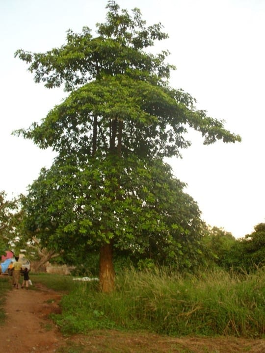

Rattray racontait ce mythe pour contredire une autre idée. Ellis, d’après qui le dieu du ciel des Akan avait été emprunté aux missionnaires européens, affirmait qu’on ne lui offrait ni sacrifice ni culte et qu’il n’avait pas de prêtres. Rattray répondit en 1923 que presque chaque concession asante possède un autel au dieu du ciel, une branche fourchue appelée *Nyame dua*, « l’arbre de Dieu », qui porte un récipient d’offrandes. Il signale aussi des temples dans les anciens palais[^47]. Le dieu lointain n’est donc pas forcément un dieu sans culte.

### Dieux lointains

La même distance apparaît ailleurs, sous des formes différentes. Chez les Yoruba, Olọ́run est, selon Ellis, trop loin ou trop indifférent pour intervenir. On ne l’invoque guère qu’en dernier recours[^48]. Johnson le dit « trop élevé » pour s’occuper directement des hommes, d’où les orisha qui servent d’intermédiaires[^49]. Chez les Bushongo, d’après Torday, le créateur Chembe ne communique plus avec les hommes que par des rêves et ne reçoit aucun véritable culte[^50]. Chez les Baganda, en revanche, le créateur Katonda avait un petit temple et quelques offrandes, mais peu d’attention[^51].

Au Rwanda, [Imana](fiche:imana) est, selon Alice Werner, une aide dans la détresse, mais on ne le prie jamais directement. On exprime plutôt un souhait conditionnel : « si Imana était avec moi, il m’aiderait ». Werner cite aussi des proverbes : « Imana a les bras longs », « nul n’est égal à Imana »[^52]. Le Rwandais Alexis Kagame, prêtre et philosophe, consacrera plus tard deux livres à la pensée bantoue de l’être ; la place qu’il y donne aux catégories d’Aristote a été vivement discutée[^53].

### Nzame, le premier homme devenu Dieu

Le cas fang, au Gabon, en Guinée équatoriale et au sud du Cameroun, montre comment un dieu suprême peut naître d’une traduction. Aujourd’hui, [Nzame](fiche:nzame) est le nom de Dieu. En 1904, E. Allégret notait déjà que ce nom était toujours suivi d’une formule que personne ne savait lui expliquer : « Nzam eñga ne Mebeghe, Mebeghe Menkwa, Sokuma, Mbongwé ». Les uns lui disaient que [Mebeghe](fiche:mebeghe) était le père, mort, et que Nzame demeurait ; d’autres que Mebeghe était le fils de Sokume, sa femme. Allégret décida qu’il s’agissait d’anciens qualificatifs de Dieu et ajouta : « Tous les Fan à qui je les ai expliqués ont immédiatement compris »[^54]. Les généalogies fang se terminaient par « fils de Nzame » ; Allégret y vit la paternité de Dieu[^55].

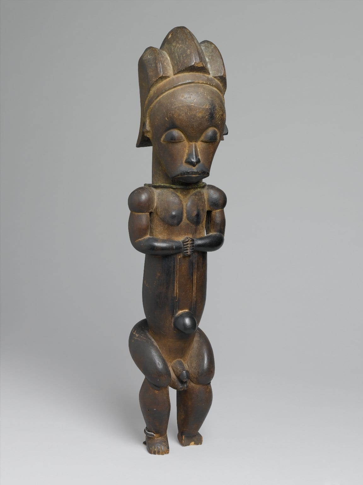

L’anthropologue Giorgio Samorini lit ces mêmes données autrement. À la suite de Pierre Alexandre et de Jacques Binet, il soutient que Nzame désignait d’abord le premier homme, créé par Mebeghe, dernier d’une longue chaîne d’êtres célestes, et que les missionnaires ont fait de ce premier homme le Dieu unique. Alexandre et Binet y voyaient une méprise, André Mary une manipulation délibérée[^56]. Le récit le plus reproduit, [la création selon Nzame, Mebere et Nkwa](fiche:creation-nzame-mebere-nkwa), vient du père Henri Trilles, qui le tenait d’un Fang converti. Il commence par un dieu « un et trois » ; dans la suite, les trois figures agissent séparément, ce qui fait penser à Samorini que la phrase a été ajoutée[^57].

> [!NOTE]
> **Le « dieu oisif » et l’Être suprême africain** : les historiens des religions appellent *deus otiosus*, « dieu oisif », un créateur qui s’est retiré après son œuvre et qui ne reçoit guère de culte. Mircea Eliade et Lawrence Sullivan, qui en font une catégorie comparative, citent des récits d’Afrique où le ciel, d’abord posé sur la terre, s’éloigne après avoir été heurté par des femmes qui pilaient le grain. Selon eux, l’absence de culte est un trait de cette figure, et non le signe d’une religion « dégénérée »[^58].
> 
> D’autres auteurs contestent la notion même d’Être suprême africain. Le poète et anthropologue ougandais Okot p’Bitek, en 1971, accusait ethnologues chrétiens, missionnaires et théologiens africains d’avoir « hellénisé » les dieux africains en leur prêtant l’éternité, l’omniscience ou l’omnipotence du Dieu chrétien. Il écrivait que ces divinités « vêtues des attributs du Dieu chrétien » sont « pour l’essentiel des créations » des chercheurs. Chez les Acholi, qu’il étudiait, il ne trouvait pas de dieu au-dessus des autres[^59]. Robin Horton a repris une partie de cette critique en 1984. Selon lui, la tradition de lecture qu’il nomme l’« opposition dévote » a déformé les religions africaines en y projetant la place que le christianisme donne à Dieu[^60].
> 
> Le théologien kényan John Mbiti a défendu la position inverse. Il a réuni plus de deux mille noms de Dieu, conclu que tous les peuples africains connaissent un Être suprême et décrit les Africains comme « notoirement religieux ». Ses critiques lui reprochent de généraliser à tout le continent et de lire ces croyances comme une préparation au christianisme. Platvoet et van Rinsum, qui le critiquent, comprennent cette image d’une Afrique profondément religieuse comme une réponse aux descriptions coloniales d’un continent « sauvage » et sans religion[^61].

## Quelle est la raison de la mort ?

Une partie des récits de l’origine ne parle pas de la création du monde, mais de la venue de la mort. Ces récits ne mettent pas toujours en scène un créateur lointain, mais une famille, un messager ou un animal.

### Kintu, Nnambi et Walumbe

Chez les Baganda, le récit publié par le missionnaire John Roscoe en 1911 commence avec un homme seul et sa vache, [Kintu](fiche:kintu). [Nnambi](fiche:nnambi), fille de Gulu, le roi du ciel, descend avec son frère, tombe amoureuse de lui et le lui dit. Gulu soumet Kintu à des épreuves :

- manger un repas préparé pour cent personnes ;
- couper du bois dans le roc ;
- rapporter de la rosée ;
- retrouver sa vache dans un immense troupeau, ce qu’il réussit grâce à une abeille.

Ensuite, il lui donne sa fille, mais les presse de partir avant que [Walumbe](fiche:walumbe), la Mort, frère de Nnambi, n’arrive, et de ne pas revenir s’ils oublient quelque chose. En chemin, Nnambi retourne chercher le grain de sa poule. Walumbe la suit. Il réclame un enfant du couple pour cuisinier, et devant le refus de Kintu, les enfants se mettent à mourir. Gulu envoie un autre fils, Kaikuzi, pour le ramener. Il le traque, mais des enfants qui voient la Mort poussent un cri et elle s’enfuit sous terre. Depuis, elle vit sur la terre[^62]. Walumbe avait un temple à Ttanda, que chaque roi honorait à son couronnement[^63].

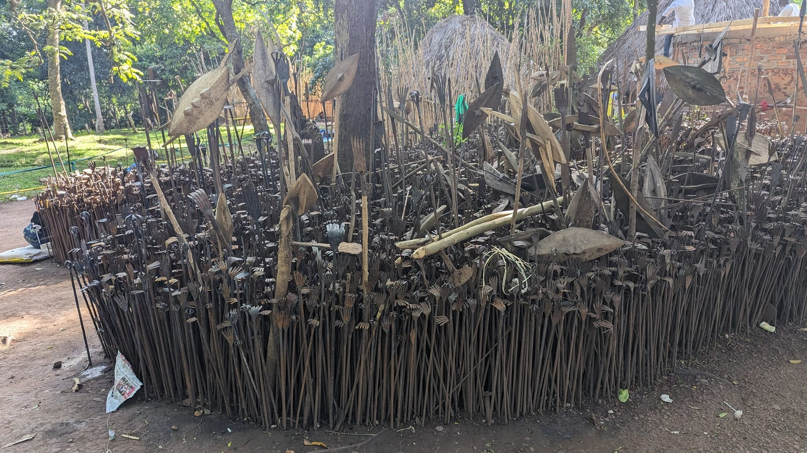

### Le caméléon et le lézard

Chez les Zulu, selon les informateurs du missionnaire Henry Callaway, [uNkulunkulu](fiche:unkulunkulu), « le très ancien », est sorti de l’*uthlanga*, la roselière d’où sont issus les êtres, et en a tiré les peuples. Il envoya le caméléon dire « que les hommes ne meurent pas ». Le caméléon traîna en chemin et s’arrêta pour manger des baies. uNkulunkulu envoya alors le lézard dire « que les hommes meurent ». Le lézard arriva le premier, et quand le caméléon parvint enfin, les hommes répondirent : « nous avons entendu la parole du lézard »[^64].

Callaway notait que ses interlocuteurs rendaient un culte aux ancêtres et tenaient le premier ancêtre pour le créateur. Un informateur d’une autre région lui disait même que le caméléon avait été envoyé par Unsondo, « celui qui sortit le premier »[^65]. Werner rapportait que presque tous les peuples bantous connaissent une forme de ce récit. Chez les Khoekhoe, en revanche, le messager est un lièvre envoyé par la lune[^66].

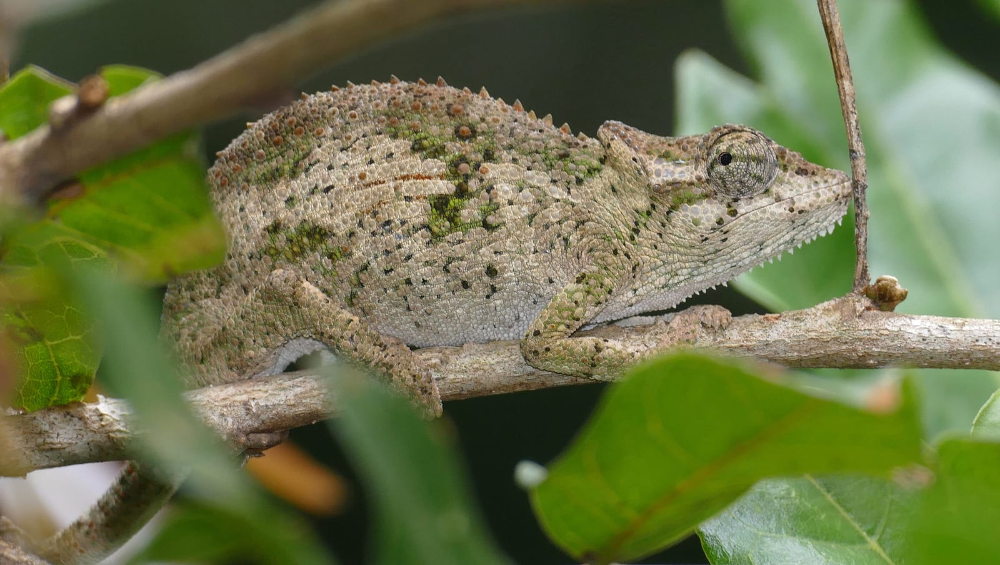

Au Rwanda, un récit publié par le missionnaire Johanssen et repris par Werner remplace le caméléon par un serpent. Imana annonce à un homme qu’il viendra de nuit lui apporter une bonne nouvelle. L’homme s’endort, le serpent caché dans la case répond à sa place et reçoit la promesse de renaître en changeant de peau, tandis que les humains mourront[^67].

### La lune de Kaggen

Chez les /Xam, un peuple san du Cap, la mante religieuse [Kaggen](fiche:kaggen) est à la fois fondatrice et farceuse. Dans un récit publié par Dorothea Bleek en 1924, Kaggen fabrique un éland avec la sandale de son gendre /Kwammang-a et le nourrit de miel en secret. /Kwammang-a le tue d’une flèche ; les suricates le dépècent et battent le vieil homme. En colère, Kaggen perce la vésicule biliaire de l’éland et le monde est plongé dans le noir. Il jette alors sa sandale dans le ciel : « cette sandale qui est la mienne deviendra la lune qui brille dans l’obscurité ». C’est pourquoi la lune est froide, parce qu’elle est de cuir, et rouge, à cause de la poussière[^68]. La fiche [Comment Kaggen créa la lune](fiche:lune-de-kaggen) donne les autres versions.

Dans d’autres récits du même corpus, la lune est un homme que le soleil transperce de ses rayons et qui renaît[^69]. Les /Xam ne rendaient pas de culte à Kaggen, mais priaient la lune qu’il avait créée[^70].

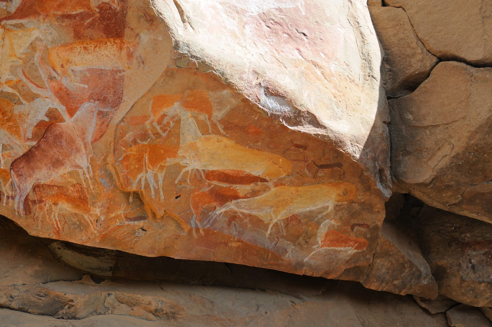

## De l’autre côté de l’Atlantique

Dans les religions afro-américaines, la création ne vit pas surtout dans des récits. Elle vit dans le culte, les correspondances entre dieux et saints et le rang des divinités.

Au Brésil, le sociologue Reginaldo Prandi rappelle que la religion des orixás connaît un dieu suprême, Olorum ou Olodumare, mais que ce sont les orixás qui exercent le pouvoir divin sur le monde[^71]. [Oxalá](fiche:oxala), héritier d’Ọbàtálá, y est associé à la création du monde et de l’espèce humaine. Le dossier du patrimoine brésilien sur la fête du Bonfim, à Salvador, le décrit comme le « père majeur » des nations afro-brésiliennes[^72]. Il est identifié au Christ, « par la position supérieure de chacun ». Parmi les noms qui lui correspondent dans les nations de candomblé figurent Lembá et Lissá : le nom du Lisa fon se retrouve ainsi auprès d’un orixá d’origine yoruba[^73]. Dans les années 1940, le chroniqueur João da Silva Campos résumait sa place à Salvador d’une phrase : « Oxalá, ici à Bahia, c’est le Senhor do Bonfim »[^74]. [Nanã](fiche:nana), elle, est associée à sainte Anne « pour son ancienneté »[^75].

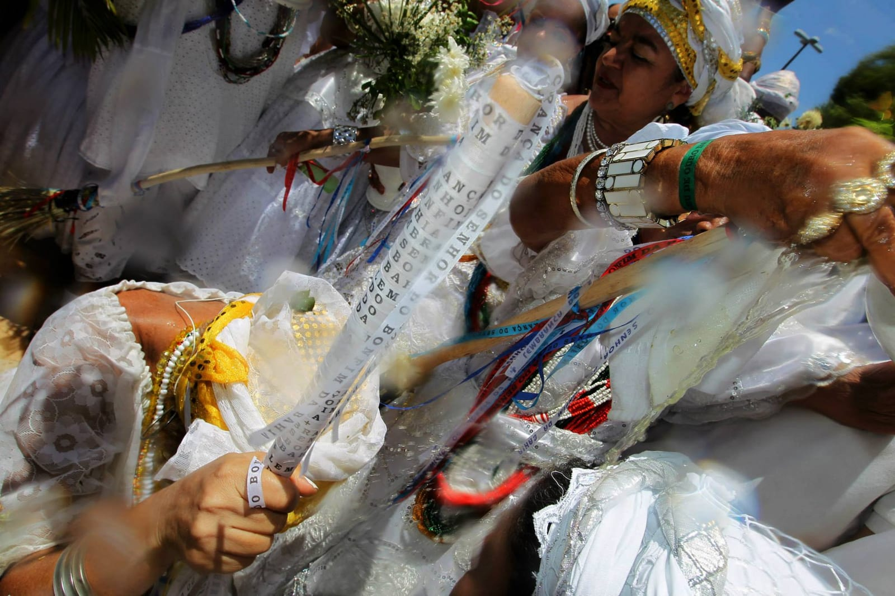

En Haïti, Émile Marcelin, lui-même haïtien, décrit en 1947 [Damballah-Wèdo](fiche:damballa) comme l’un des plus hauts lwa du rite rada, dieu des sources et des rivières, qui se manifeste sous la forme d’une couleuvre. Sa femme, Aïda-Wèdo, est la déesse de l’arc-en-ciel : quand on voit deux arcs-en-ciel, ce sont les deux divinités ensemble[^76]. Le nom d’Aïda-Wèdo rappelle celui d’Aido-wedo, le serpent arc-en-ciel relevé par Ellis à Ouidah et à Porto-Novo. Les sources réunies ici ne permettent pas de suivre le chemin de l’un à l’autre. Damballah est identifié à saint Patrick, qui chasse les serpents, ou à Moïse[^77]. Au-dessus des lwa se tient le Bon Dieu, que les chants invoquent : on demande au lwa Sobo de laisser ses enfants « entre les mains du Bon Dieu »[^78].

Ces cultes ont donc gardé des dieux créateurs, un dieu suprême et des serpents cosmiques, mais pas de cosmogonie racontée de bout en bout. Alfred Métraux, qui présentait le travail de Marcelin, remarquait que cette mythologie se donnait d’abord à voir dans le comportement des possédés lors des cérémonies[^79]. Les sources réunies ici ne permettent pas d’affirmer qu’un récit complet de la création ait été transmis en Haïti ou au Brésil.

## Ce qu’on retient !

### Des manières de créer

| Récit                 | Peuple                      | Mode de création                                              | Source principale                                      |
| --------------------- | --------------------------- | ------------------------------------------------------------- | ------------------------------------------------------ |
| Atoum et l’Ennéade    | Égyptiens anciens           | émergence des eaux, rejet de Shou et Tefnout                  | *Textes des Pyramides*, d’après Breasted 1912          |
| Ptah                  | Égyptiens anciens (Memphis) | pensée du cœur, parole de la langue                           | pierre de Shabaka, d’après Breasted 1912 et Lesko 1987 |
| Khnoum                | Égyptiens anciens           | façonnage sur le tour de potier                               | Breasted 1912                                          |
| Ọbàtálá et Odùduwà    | Yoruba                      | délégation, façonnage dans l’argile, terre répandue sur l’eau | Ellis 1894 ; Johnson 1921                              |
| Bumba                 | Kuba (Bushongo)             | vomissement                                                   | Torday et Joyce 1910                                   |
| Mawu, Lisa, Aido-wedo | Fon, Ewe                    | couple d’astres, serpent arc-en-ciel                          | Ellis 1890 ; Maupoil, d’après Cousin Kouton 2023       |
| Pemba et Faro         | Bambara, Malinké            | première création impure, sacrifice, arche                    | Dieterlen 1955 ; Jeanmaire 1952                        |
| Amma, Ogo et le Nommo | Dogon                       | signes, double placenta, sacrifice, arche                     | Griaule et Dieterlen 1965, d’après de Heusch 1968      |
| Nyame                 | Akan (Asante)               | ciel éloigné par le pilon                                     | Rattray 1916                                           |
| Mebeghe et Nzame      | Fang                        | création du premier homme ; dieu unique selon Trilles         | Allégret 1904 ; Samorini 2024                          |
| Kintu et Walumbe      | Baganda                     | mort venue du ciel avec l’épouse                              | Roscoe 1911                                            |
| uNkulunkulu           | Zulu                        | sortie de la roselière ; message manqué                       | Callaway 1868-1870                                     |
| Kaggen                | /Xam (San)                  | lune née d’une sandale                                        | Bleek 1924                                             |

Le tableau montre qu’aucun « mode » n’appartient à une région. La parole créatrice se trouve à Memphis et chez les Dogon, le façonnage chez Khnoum comme chez Ọbàtálá, l’éloignement du ciel chez les Asante comme dans les récits que citent Eliade et Sullivan. Le vomissement de Bumba a un lointain parent dans Atoum qui « rejette » Shou, mais rien ne permet de supposer une filiation entre eux.

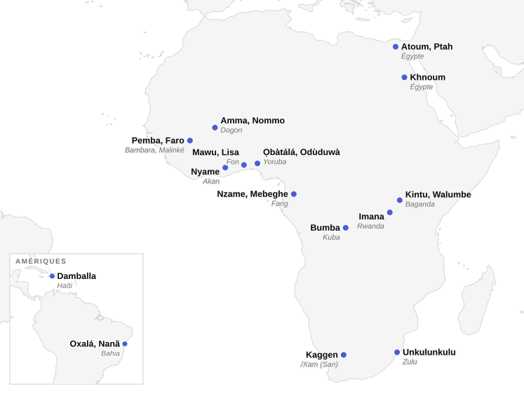

### Missionnaires et ethnologues

Presque tous ces récits ont été écrits par d’autres personnes que ceux qui les racontaient ; et plusieurs ont été réinterprétés au moment même où ils étaient recueillis. Le missionnaire Pierre Bouche, en 1885, voyait dans le premier homme yoruba, Obbalofoun, « roi de la parole », un Adam, et dans la première femme, Iyé, « la vie », une Ève. Il jugeait ces traditions « calquées sur la Bible »[^80]. Callaway jugeait « malavisé » le choix, par les premiers missionnaires établis chez les Xhosa, du mot Utikxo pour traduire « Dieu »[^81]. Ellis notait que les prêtres catholiques de la côte s’appelaient eux-mêmes « prêtres de Mawu » et que les convertis confondaient Mawu et Jéhovah[^82]. L’exemple fang montre jusqu’où peut aller cette réécriture : un nom de premier homme devient le nom de Dieu, et les Fang finissent par tenir Mebeghe pour un ancien nom de Nzame[^83].

Les ethnologues coloniaux ont eu leurs propres lunettes. Torday entendait la Genèse dans l’ouverture du récit de Bumba. Griaule et Dieterlen comparaient la pensée dogon et bambara à celle des Grecs et des Égyptiens. Griaule disait la cosmogonie dogon « aussi riche que celle d’Hésiode ». Ces comparaisons ont d’abord servi à affirmer la valeur des pensées africaines contre le vocabulaire de l’« animisme » et du « fétichisme »[^84]. Elles ont aussi encouragé des présentations très systématiques, que la controverse Griaule a mises en question.

### Savants africains

Les savants africains n’ont pas formé un camp unique. Le pasteur yoruba Samuel Johnson rapporte la tradition qui fait venir Odùduwà de La Mecque, tout en la jugeant erronée et en situant plutôt « l’Est » des origines en Égypte ou en Arabie[^85]. Alexis Kagame a cherché dans le kinyarwanda des catégories de l’être comparables à celles d’Aristote. John Mbiti a défendu l’idée d’un Être suprême commun à tout le continent, Okot p’Bitek l’a combattue. Les philosophes Fabien Éboussi-Boulaga et Marcien Towa ont critiqué l’ensemble de cette « ethnophilosophie », qui cherchait, selon eux, à prouver à l’Occident que l’Afrique avait elle aussi une philosophie[^86]. En Haïti, la collecte d’Émile Marcelin a été revue « du point de vue de la forme » par Métraux[^87].

### Ce que l’écriture a figé

L’écriture a souvent figé une version parmi d’autres. Les scribes de Shabaka ont sauvé un texte qu’ils disaient illisible, et c’est leur copie, non l’original, que l’on date. Dieterlen a reconstitué *Le Renard pâle* à partir d’informations dispersées, car aucun texte dogon suivi n’existait[^39]. Dorothea Bleek, qui publiait les carnets de son père et de sa tante, dit avoir raccourci certains récits en supprimant des « répétitions fastidieuses »[^88]. Les récits ne disparaissent pas pour autant de l’oral, mais les premières versions imprimées, celles de Torday, de Callaway ou de Roscoe, restent, comme dans ce dossier, les plus citées, avec les choix de ceux qui les ont mises par écrit.

Les récits de l’origine n’ont jamais eu partout le même poids. Certains peuples n’en avaient pas. Certains les réservaient aux initiés. D’autres, comme les Asante ou les Baganda, les racontaient pour expliquer pourquoi Dieu est loin et pourquoi l’on meurt, sans décrire la création du monde. Le pluriel de « cosmogonies » n’est donc pas une précaution de style ; il décrit l’état des sources.

[^1]: Torday et Joyce (1910), p. 20. Torday écrit « Bumba, le Chembe (Dieu) ». Ailleurs, il donne Chembe (Jambi dans l’est) comme nom du créateur (p. 120). Les noms des créatures varient d’une transcription à l’autre.

[^2]: Breasted (1912), p. 43-47. Breasted lisait le texte d’après sa propre copie de la stèle (1901) et l’étude d’Adolf Erman (1911).

[^3]: Han et Beyers (2017), p. 15-16, qui citent G. Setiloane (1976, p. 81) pour les Sotho-Tswana et O. p’Bitek (1971, p. 45 et 50) pour les Luo centraux. Les auteurs citent aussi le Ruwa des Chagga, qui n’est pas le créateur du monde.

[^4]: Horton (1984), p. 407, d’après Monica Wilson (1959, p. 154-165). Horton cite aussi le cas des Gogo, chez qui le créateur supposé, Maduwo, est une puissance vague et plutôt malveillante, d’après Peter Rigby (1966).

[^5]: Torday et Joyce (1910), p. 19. L’auteur en tire un éloge des Bushongo, tout en classant une partie de leurs « racontars » dans la légende plutôt que dans l’histoire.

[^6]: Dieterlen (1955), p. 40. Ce sont les Dyabaté du village de Kéla qui récitent le mythe de la création, puis les généalogies, lors de la réfection septennale du sanctuaire de Kangaba, à laquelle l’autrice assista en avril 1954.

[^7]: Breasted (1912), p. 10-11. Breasted ne cite pas ici de texte précis pour chaque version et parle de croyances propres à chaque sanctuaire.

[^8]: *Textes des Pyramides*, § 1652, dans la traduction anglaise de Breasted (1912), p. 76-77, retraduite ici ; la référence au paragraphe est donnée par Breasted, p. 11, note 2. Breasted traduit les deux verbes par *spew out* et *spit out* ; d’autres traductions parlent d’« éternuer » Shou. Breasted rapproche la pierre *ben* du *benben* qui surmonte les obélisques et les pyramides (p. 70-72).

[^9]: Breasted (1912), p. 10-11, d’après les *Textes des Pyramides* (§ 1778). L’image d’un Shou qui soutient le ciel, comparé par Breasted à Atlas, est l’interprétation de l’auteur.

[^10]: Breasted (1912), p. 43 et p. 46, note 1, qui parle de scribes du VIIIe siècle avant notre ère ; Lesko (1987) date la copie de la XXVe dynastie, vers 700. Breasted la numérote « Stela No. 797 » du British Museum, acquise en 1805.

[^11]: Breasted (1912), p. 44-46, qui traduit les lignes 48 à 61 de la stèle. Breasted signale que le pronom peut renvoyer au cœur ou à la langue, de même genre en égyptien (p. 45, note 1).

[^12]: Breasted (1912), p. 46-47, note 1. Breasted revient explicitement sur sa date de 1901 et sur la présentation qu’il en donnait dans son *History of Egypt*.

[^13]: Lesko (1987). Lesko précise que le créateur ainsi créé par Ptah est Atoum, qui fait ensuite les autres dieux de l’Ennéade d’Héliopolis. Il ne donne pas de date précise pour l’original.

[^14]: Breasted (1912), p. 209, qui traduit les *Admonitions* : « Khnum (creator of man) fashions not (men) by reason of the state of the land ». Les textes d’Esna où Khnoum crée les dieux, les hommes et les animaux sont présentés dans sa fiche.

[^15]: Ellis (1894), p. 38-39. Ellis cite « les prêtres » sans les nommer.

[^16]: Ellis (1894), p. 39-40. Ellis ne dit pas quel mythe contredit celui de l’argile.

[^17]: Johnson (1921), chapitre « Religion », p. 27. Johnson énumère aussi les noms locaux d’Òrìṣàńlá, dont Òrìṣàgiyan à Ejigbo et Ọbàtálá à Oba.

[^18]: Ce récit est présenté dans les fiches d’Ọbàtálá et d’Odùduwà. Les sources réunies ici ne permettent pas de dater son apparition dans les traditions publiées.

[^19]: Ellis (1894), p. 41-42. Ellis précise que l’interprétation androgyne n’est « pas commune » et que les deux divinités sont presque toujours tenues pour distinctes. Il rapporte aussi un mythe où, enfermés dans une calebasse au commencement du monde, les deux époux se querellent et Ọbàtálá arrache les yeux d’Odùduwà.

[^20]: Johnson (1921), p. 9. Johnson rattache cette version au dicton « l’Aláàfin est le seigneur de la terre » et préfère une autre explication de la prééminence d’Ọ̀rànmíyàn.

[^21]: Ellis (1894), p. 64. Ellis ne dit pas sur quoi il fonde l’hypothèse d’un emprunt à l’islam.

[^22]: Torday et Joyce (1910), p. 20. La foudre, Tsetse Bumba, est décrite comme un animal semblable à un léopard noir. Torday nomme Loko Yima comme le seul homme « blanc comme lui ».

[^23]: Torday et Joyce (1910), p. 20.

[^24]: Torday et Joyce (1910), p. 20-21. Selon Torday, les hommes obtiennent d’abord le feu des arbres frappés par la foudre ; la manière de le faire par friction n’est révélée en rêve que bien plus tard, sous le règne du chef Muchu Mushanga (p. 24 et 237).

[^25]: Torday et Joyce (1910), p. 20. Les auteurs ne précisent pas dans quelle langue le récit leur a été dit, ni par qui.

[^26]: Maupoil, *La Géomancie à l’ancienne Côte des Esclaves* (1943), d’après Cousin Kouton (2023), chapitre 7, § 2 et note 8.

[^27]: Skertchly (1874), p. 461 et 472-473. Skertchly appelle les divinités secondaires des « fétiches », vocabulaire de son temps. Il ajoute que ce dieu suprême serait « le même que le Dieu de la civilisation », formule qui reflète surtout le point de vue de l’auteur.

[^28]: Ellis (1890), p. 31-36. Ellis emploie un vocabulaire racial méprisant, notamment pour expliquer l’idée d’un dieu au repos ; il n’est retenu ici que pour ce qu’il rapporte. Sa thèse d’un dieu du ciel sans rôle de créateur s’oppose à celle de Maupoil.

[^29]: Ellis (1890), p. 65-66. Ellis précise que le soleil est appelé *whi* en fon et que Lisa est servi au Dahomey et dans les États ewe de l’est. Il ne mentionne pas d’union entre Lisa et Mawu.

[^30]: Ellis (1890), p. 47-49. Ellis donne la graphie de Burton, *Aydo-whe-do*, et celle des missionnaires français, *Aido-wedo*. Il dit écrire de mémoire l’étymologie qu’il propose.

[^31]: Jeanmaire (1952), p. 116-117. Jeanmaire présente le livre de Dieterlen, issu de missions de 1946 à 1949. Il compare ces mythes à Hésiode, à l’orphisme et aux gnostiques, comparaisons qui sont les siennes ; son vocabulaire (« paléo-nigritien », « barbare ») date de son époque.

[^32]: Jeanmaire (1952), p. 116, note 1, qui renvoie à S. de Ganay, « Notes sur la théodicée bambara », *Revue de l’histoire des religions*, 135, 1949.

[^33]: Dieterlen (1955), p. 43-46. Dans cette version, Faro appartient à la seconde paire de jumeaux et la jumelle de Pemba est Mousso Koroni Koundyé ; Faro n’est pas le jumeau de Pemba. Le nombre des morceaux du corps de Faro n’est pas donné ici.

[^34]: Dieterlen (1955), p. 46-47. L’autrice note que, avant les semailles, le plus âgé des chefs de famille d’un quartier ouvre encore la cérémonie en disant « *nko* ».

[^35]: Dieterlen (1955), p. 42. Le texte publié par l’autrice est donné « dans sa version mandingue » ; les versions bozo, bambara, kouroumba, samogo et dogon ne sont pas détaillées dans cet article.

[^36]: Tamari (2001), p. 93, pour l’année des entretiens et la date de 1948. De Heusch (1968, p. 70) date *Dieu d’eau* de 1947.

[^37]: De Heusch (1968), p. 71-74, qui renvoie aux p. 129-130, 239, 261 et 269 du *Renard pâle* et cite la formule des auteurs sur le Renard qui « incarne les contradictions inhérentes à la condition humaine » (p. 53).

[^38]: De Heusch (1968), p. 79, qui renvoie à *Dieu d’eau*, p. 24.

[^39]: De Heusch (1968), p. 71 et 78-79, qui cite *Le Renard pâle*, p. 55-56. Selon les auteurs, certaines séquences ne sont connues que par des invocations très abrégées dans la langue rituelle du Sigui ou par des prières.

[^40]: Van Beek (1991), p. 148, cité par Apter (2005), § 9-10. Van Beek relève aussi des influences chrétiennes et musulmanes anciennes dans la région de Sanga, où Griaule travaillait.

[^41]: Tamari (2001), p. 108, qui donne la liste : commentaires de R.M.A. Bédaux, S.P. Blier, J. Bouju, P.I. Crawford, M. Douglas, P. Lane et C. Meillassoux dans *Current Anthropology*, 32(2), 1991 ; réponses de L. de Heusch, 32(4), et de G. Calame-Griaule, 32(5) ; réplique de van Beek, 33(2), 1992.

[^42]: Apter (2005), § 2, 11 et 16-17. Apter s’appuie sur ses propres recherches sur les savoirs secrets yoruba à Ayede-Ekiti.

[^43]: Tamari (2001), p. 95-99. L’autrice qualifie la position de van Beek de « cas le plus extrême » de scepticisme (p. 95, note 15) et conteste son idée d’une influence chrétienne (p. 96, note 19). Elle présente son étude comme une « ébauche ».

[^44]: Tamari (2001), p. 94, qui cite l’*Essai sur la religion bambara* (1951, rééd. 1988, p. 21).

[^45]: Jeanmaire (1952), p. 118.

[^46]: Rattray (1916), p. 20-21, qui donne le texte twi et sa traduction littérale, retraduite ici. Rattray ajoute que beaucoup d’autres légendes pourraient être citées.

[^47]: Rattray (1923), chapitre XIII, p. 139-142, qui cite Ellis, *The Tshi-Speaking Peoples of the Gold Coast* (1887). Rattray (1916, p. 18-22) défendait déjà l’ancienneté du dieu du ciel, tout en admettant une possible influence musulmane ancienne.

[^48]: Ellis (1894), p. 36-37. Ellis relève toutefois des formules de salutation où le nom d’Olọ́run est prononcé chaque jour.

[^49]: Johnson (1921), chapitre « Religion », p. 26.

[^50]: Torday et Joyce (1910), p. 120. Torday ajoute que, chez les Bangongo, Jambi désigne aussi l’intelligence : on dit d’un sculpteur habile que son Jambi lui a appris à sculpter.

[^51]: Roscoe (1911), p. 312. Roscoe dit qu’on l’appelait « père des dieux », parce qu’il avait tout créé, « mais on ne savait pas grand-chose de lui ».

[^52]: Werner (1933), p. 43-44, d’après les recueils missionnaires de Johanssen et Hurel. Werner note que le nom d’Imana n’appartient pas, grammaticalement, à la classe des personnes.

[^53]: Rosemann (1998), p. 294, qui renvoie à *La philosophie bantu-rwandaise de l’être* (1956) et à *La philosophie bantu comparée* (1976), et, pour la critique, à D.A. Masolo. Le statut d’Imana dans l’œuvre de Kagame n’est pas analysé dans cet article.

[^54]: Allégret (1904), p. 223-224. Allégret dit avoir mis longtemps à comprendre la formule ; c’est lui qui propose d’y voir des attributs (Mebeghe, « celui qui porte tous les hommes » ; Menkwa, « le juge » ; Sokuma, « le roi des rois » ; Mbongwé, « le père de la vie »).

[^55]: Allégret (1904), p. 223. La formule complète se termine par « lorsque le coq a chanté pour la première fois, je n’étais pas là ».

[^56]: Samorini (2024), p. 117-119, qui s’appuie sur P. Alexandre et J. Binet (1958, p. 109-110), sur Trézenem (1936) et sur A. Mary (2010). L’auteur cite aussi les généalogies divines des joueurs de mvett, d’après Tsira Ndong Ndoutoume.

[^57]: Samorini (2024), p. 119, qui cite Trilles, « Proverbes, légendes et contes fang » (1905, p. 130 et 134). Samorini rappelle que Günter Tessmann avait relevé dès 1913 les ressemblances du récit avec l’Ancien Testament. Il ajoute que d’autres travaux de Trilles ont été qualifiés de falsifications.

[^58]: Eliade et Sullivan (1987). Les auteurs attribuent le récit des femmes qui pilent à Dominique Zahan et l’appliquent aux Nuba et aux Dogon. Ils reconnaissent que les contacts avec le christianisme ou l’islam ont pu modeler certaines formes, sans exclure une structure indigène. Ils ne disent pas qui a forgé l’expression *deus otiosus*.

[^59]: P’Bitek, *African Religions in Western Scholarship* (1971, p. 41, 79-80, 88) et « The Concept of Jok among the Acholi and Lango » (1963), d’après Platvoet et van Rinsum (2003), p. [136]-[138] de la pagination originale, et Horton (1984), p. 410, pour la citation sur les divinités « vêtues des attributs du Dieu chrétien ».

[^60]: Horton (1984), p. 391-392 et 403-404. Horton cite parmi les auteurs visés E.E. Evans-Pritchard, Victor Turner, Bolaji Idowu et John Mbiti ; il qualifie la critique de p’Bitek de « pénétrante » tout en regrettant son style polémique.

[^61]: Han et Beyers (2017), p. 12-16, d’après Mbiti, *African Religions and Philosophy* (1969) et *Concepts of God in Africa* (1970) ; Platvoet et van Rinsum (2003), p. [127]-[135]. Ces deux articles sont critiques envers Mbiti ; Platvoet et van Rinsum présentent le thème d’une Afrique « profondément religieuse » comme une réponse aux images coloniales.

[^62]: Roscoe (1911), p. 460-464. Roscoe écrit Gulu, Nambi et Tanda ; l’orthographe actuelle est Ggulu, Nnambi et Ttanda. Roscoe fait d’abord venir Nnambi « avec son frère », puis parle de ses frères quelques lignes plus loin.

[^63]: Roscoe (1911), p. 315-316. Seul le roi faisait des offrandes à Walumbe, et seulement à la demande des autres dieux.

[^64]: Callaway (1868-1870), p. 1-4, qui donne le texte zulu et sa traduction anglaise, retraduite ici. Le lézard est l’*intulo*. Callaway note que le caméléon et plus encore le lézard sont souvent tués à cause de ce récit.

[^65]: Callaway (1868-1870), p. 1, note 2, et p. 15-16, pour l’informateur Ibakca.

[^66]: Werner (1933), p. 31-33. Werner donne la version de Callaway et plusieurs variantes, dont celle où le lézard surprend le message et le devance par malice.

[^67]: Werner (1933), p. 44-45, d’après Johanssen, *Ruanda* (1912), p. 119. Werner y voyait une « influence hamitique », hypothèse raciale aujourd’hui abandonnée ; le récit n’est retenu ici que pour son contenu.

[^68]: Bleek (1924), p. 1-5, « The Mantis makes an Eland (First Version) », retraduit ici. L’ouvrage ne nomme pas le narrateur de cette version.

[^69]: Bleek et Lloyd (1911), p. 38, note, et p. 53, note. Les éditeurs y opposent la lune « morceau de cuir » des récits de la mante à la lune « homme » de l’« astrologie » des /Xam.

[^70]: Bleek (1924), introduction. Dorothea Bleek précise que les narrateurs vivaient au sud du fleuve Orange et avaient vu leur pays envahi par les colons blancs.

[^71]: Prandi (2011), p. 24, qui renvoie à Verger (1996).

[^72]: Couto, Reis et Moura (2010), p. 5, note 1.

[^73]: Prandi (2011), p. 23-24. Prandi présente ces équivalences entre orixás, voduns et inquices comme « presque complètes ».

[^74]: João da Silva Campos, dans les *Anais do Arquivo Público da Bahia*, cité par Couto, Reis et Moura (2010), p. 30. La traduction est la nôtre.

[^75]: Prandi (2011), p. 23. La fiche de Nanã présente son lien avec Nana Buluku et ses mythes brésiliens ; les sources réunies ici ne permettent pas de dire si un récit de création associé à Nanã circule dans les terreiros sous une forme fixe.

[^76]: Marcelin (1947), p. 65-66 et 71-72. Marcelin rapporte aussi que l’arc-en-ciel est vu comme une gigantesque couleuvre céleste dont la partie sombre est Damballah.

[^77]: Marcelin (1947), p. 66-67. Certains prêtres distinguent un Damballah rada, identifié à Moïse, et un Damballah petro, identifié à saint Patrick. Marcelin appelle les dieux venus d’Afrique les « loa de Guinée ».

[^78]: Marcelin (1947), p. 112 et 114. Un autre chant rapporte la formule « Agaou dit : si Bon Dieu veut ».

[^79]: Métraux, introduction à Marcelin (1947), p. 53. Dans la même introduction (p. 52), Métraux regrette que l’État haïtien n’ait pas fait appel à des missionnaires pour évangéliser les campagnes, ce qui montre les présupposés de l’époque.

[^80]: Bouche (1885), chapitre XV, « Les origines : simples notes ». Bouche s’appuie en partie sur Samuel Crowther pour les étymologies, qu’il interprète à sa façon. Dans le même livre (chapitre VII), il donne Oloroun pour le nom nago de Dieu et Maou pour son nom chez les « Djedjis » et les Mina.

[^81]: Callaway (1868-1870), p. 105-111. Selon Callaway, le mot venait des Khoekhoe et, d’après un témoignage qu’il tient pour exact, était le nom de louange d’un ancien héros.

[^82]: Ellis (1890), p. 35-36. Ellis ajoute que les missionnaires protestants traduisaient plus prudemment Mawu par « le dieu inconnu ».

[^83]: Samorini (2024), p. 119, d’après Alexandre et Binet (1958, p. 110).

[^84]: Griaule, préface de *Dieu d’eau* (1948), et Griaule et Dieterlen (1950), cités par Tamari (2001), p. 93-94. Jeanmaire (1952, p. 112) voyait dans ces enquêtes la preuve qu’il fallait renoncer aux notions « par trop sommaires » d’« animisme » et de « fétichisme ». Tamari rappelle que ces rapprochements furent d’abord bien accueillis, notamment par Pierre-Maxime Schuhl et par l’helléniste Henri Jeanmaire, puis critiqués par Jean-Pierre Vernant pour des raisons de méthode.

[^85]: Johnson (1921), p. 3-6. Johnson rapproche le nom de Lamurudu, ancêtre mecquois d’Odùduwà, de Nemrod, et suggère que les ancêtres des Yoruba pourraient avoir été des chrétiens coptes de Haute-Égypte (p. 7) ; ce sont ses hypothèses, non celles de la tradition qu’il rapporte.

[^86]: Rosemann (1998), p. 294-295, qui suit D.A. Masolo, *African Philosophy in Search of Identity* (1994). Rosemann cite aussi la critique selon laquelle Griaule aurait « griaulé » Ogotemmêli en rendant sa pensée trop systématique.

[^87]: Métraux, introduction à Marcelin (1947), p. 53. Métraux précise que « l’expression originale a été maintenue » autant que possible.

[^88]: Bleek (1924), introduction. Lucy Lloyd avait publié une première partie de ces récits en 1911 dans *Specimens of Bushman Folklore*.
